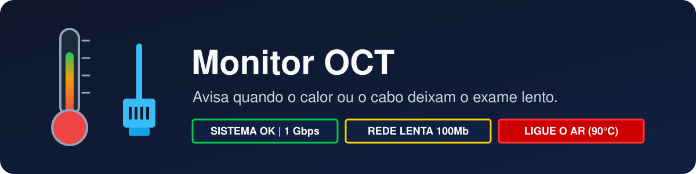
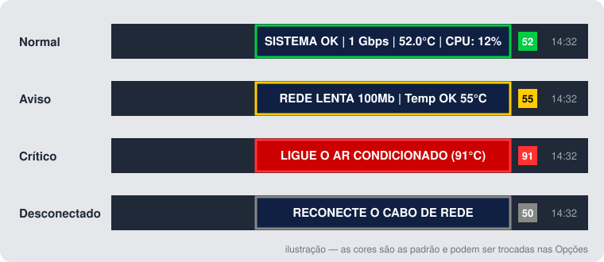
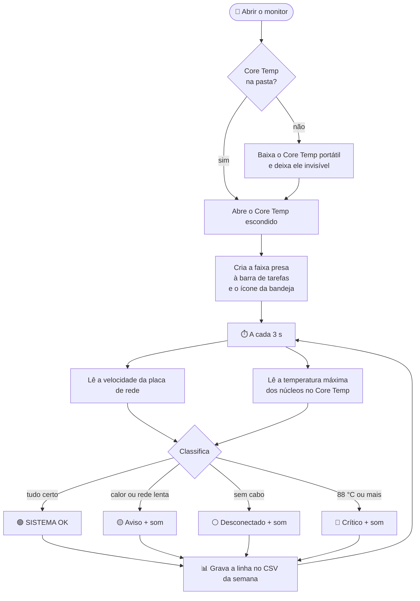

<p align="center">
  
</p>

<h1 align="center">🌡️ Monitor OCT: temperatura da CPU e velocidade da rede</h1>

<p align="center">
  <b>O exame do OCT não fica mais lento sem ninguém saber por quê.</b><br>
  Uma faixa colada na barra de tarefas do Windows mostra a temperatura do PC e a velocidade do cabo do OCT e, quando algo sai do normal, diz <b>o que fazer</b> ("LIGUE O AR CONDICIONADO", "RECONECTE O CABO DE REDE").
</p>

<p align="center">
  
  
  
  
  <a href="LICENSE"></a>
  
</p>

<p align="center">
  <a href="#-instalação">📦 Instalar</a>
  &nbsp;·&nbsp;
  <a href="#-configuração">⚙️ Configurar</a>
  &nbsp;·&nbsp;
  <a href="#-o-que-cada-cor-quer-dizer">🚦 Cores</a>
  &nbsp;·&nbsp;
  <a href="#-solução-de-problemas">🩹 Problemas</a>
</p>

---

## 📑 Sumário

- [🏥 Por que existe](#-por-que-existe)
- [✨ O que faz](#-o-que-faz)
- [🚦 O que cada cor quer dizer](#-o-que-cada-cor-quer-dizer)
- [🧭 Como funciona](#-como-funciona)
- [📋 Requisitos](#-requisitos)
- [📦 Instalação](#-instalação)
- [🚀 Como usar no dia a dia](#-como-usar-no-dia-a-dia)
- [🔧 Configuração](#-configuração)
- [🩹 Solução de problemas](#-solução-de-problemas)
- [❓ Perguntas frequentes](#-perguntas-frequentes)
- [🧰 Para quem mantém](#-para-quem-mantém)
- [📄 Licença e autor](#-licença-e-autor)

---

## 🏥 Por que existe

O OCT (DRI OCT Triton Plus) manda cada imagem para o computador por um cabo de rede direto. Entre uma captura e outra, o paciente espera.

| Situação | Velocidade do cabo | Tempo por imagem |
| :--- | :---: | :---: |
| 🟢 Tudo certo | **1 Gbps** | ~15 segundos |
| 🔴 PC quente ou mau contato no cabo | cai para **100 Mbps** | **mais de 1 minuto** |

Quando a sala esquenta ou o conector fica frouxo, a placa de rede baixa sozinha para 100 Mbps e o exame fica quatro vezes mais lento, sem nenhum aviso. O monitor mostra isso na hora, com uma instrução curta que qualquer pessoa da equipe consegue seguir.

---

## ✨ O que faz

| | Recurso | Em poucas palavras |
| :---: | :--- | :--- |
| 📌 | **Faixa na barra de tarefas** | Fica presa à barra de tarefas (ao lado da bandeja, por padrão). Não cobre o exame, não rouba o foco e o clique passa através dela. |
| 🔄 | **Mensagens que giram** | Em alerta, alterna frases curtas a cada 3 s ("REDE LENTA 100Mb" → "RECONECTE O CABO DE REDE" → "SE PERSISTIR REINICIE"). Texto comprido rola sozinho. |
| 🌡️ | **Temperatura real da CPU** | Lê a maior temperatura entre os núcleos direto da memória compartilhada do **Core Temp**, que roda escondido. |
| 🧩 | **Core Temp instalado sozinho** | Na primeira vez, baixa o Core Temp portátil do site oficial, deixa ele invisível e o reabre se for fechado. |
| 🔌 | **Velocidade do cabo** | Confere a velocidade negociada da placa de rede escolhida (1000, 100 ou 0 Mbps). |
| 🔊 | **Som de alerta** | Toca um som do Windows em alerta (no máximo a cada 30 s) e outro quando o cabo volta. Dá para silenciar por 5 min ou de vez. |
| 🔢 | **Ícone com a temperatura** | O ícone da bandeja mostra o número da temperatura, na cor do estado atual. |
| 📊 | **Relatório semanal em CSV** | Grava uma linha por leitura (data, hora, temperatura, velocidade, uso da CPU e ação recomendada), um arquivo por semana. |
| 🕹️ | **Simulador de falhas** | Aba de testes que finge calor ou queda de rede por alguns segundos, para conferir os avisos e treinar a equipe. |
| 🎨 | **Posição e cores ajustáveis** | Escolha onde a faixa fica, ajuste fino em pixels, posições salvas e cores de cada estado. |

<p align="center">
  <br>
  <sub>Ilustração da faixa na barra de tarefas (desenho, sem dados reais).</sub>
</p>

---

## 🚦 O que cada cor quer dizer

A verificação roda a cada **3 segundos**.

| Estado | Cor (padrão) | Quando acontece | O que a faixa pede |
| :--- | :---: | :--- | :--- |
| ✅ **Normal** | borda verde | Cabo em 1 Gbps e CPU abaixo de 76 °C | `SISTEMA OK \| 1 Gbps \| 52.0°C \| CPU: 12%` |
| ⚠️ **Rede lenta** | borda amarela | Cabo abaixo de 1 Gbps (ex.: 100 Mbps), CPU fria | Reconectar o cabo; se persistir, reiniciar |
| ⚠️ **Sala aquecida** | borda amarela | CPU de 76 °C até abaixo de 88 °C | Ligar o ar-condicionado antes que o exame fique lento |
| ⚠️ **Aviso misto** | borda amarela | Sala aquecida **e** rede lenta | Ar-condicionado + reconectar o cabo |
| 🔌 **Desconectado** | borda cinza | Placa de rede sem link (0 Mbps) | Reconectar o cabo; se persistir, reiniciar |
| 🚨 **Crítico** | fundo vermelho | CPU a 88 °C ou mais (sozinha, com rede lenta ou sem rede) | Ligar o ar, desligar o PC por 2 min, risco ao equipamento |

Em todos os estados de alerta o som toca (se não estiver silenciado).

---

## 🧭 Como funciona



Detalhes da leitura da memória do Core Temp, dos dois motores de exibição e do formato do CSV estão em [docs/AVANCADO.md](docs/AVANCADO.md).

---

## 📋 Requisitos

| | Item | Observação |
| :---: | :--- | :--- |
| 🪟 | **Windows 10 ou 11 (64 bits)** | A faixa usa a API do Windows para se prender à barra de tarefas. |
| 🛡️ | **Permissão de administrador** | O Core Temp precisa dela para ler os sensores da CPU. O `.exe` compilado já pede sozinho. |
| 📶 | **Internet só na primeira vez** | Para baixar o Core Temp portátil (`alcpu.com`). Depois funciona sem internet. |
| 🔌 | **Placa de rede ligada ao OCT** | Você escolhe qual placa monitorar nas Opções. |
| 🐍 | **Python 3** *(só se não usar o `.exe`)* | Bibliotecas: `psutil`, `pywin32`, `Pillow`, `pystray`. |

---

## 📦 Instalação

### Opção A: com Python

```bash
git clone https://github.com/Nicker2/OCT-MONITOR-NETWORK-TEMP.git
cd OCT-MONITOR-NETWORK-TEMP
pip install psutil pywin32 pillow pystray
```

Abra um **Prompt de Comando como administrador**, entre na pasta e rode:

```bash
python oct-monitor-cpu-network-temp.py
```

Na primeira vez ele cria a pasta `lib_coretemp\` com o Core Temp e o `config.json` com a primeira placa de rede que encontrar. Abra as **Opções** e confira se a placa escolhida é a do OCT.

### Opção B: gerar um `.exe` portátil

Para instalar no PC do OCT sem Python, compile com o PyInstaller. O executável já nasce pedindo administrador:

```bash
pip install pyinstaller
python -m PyInstaller --onefile --noconsole --name "MonitorOCT" --uac-admin oct-monitor-cpu-network-temp.py
```

O `MonitorOCT.exe` fica em `dist\`. Copie para uma pasta só dele, por exemplo `C:\MonitorOCT\`: é nessa pasta que ficam o relatório CSV e o `lib_coretemp\`.

> [!NOTE]
> Veja em [Perguntas frequentes](#-perguntas-frequentes) onde o `.exe` de arquivo único guarda o relatório CSV.

---

## 🚀 Como usar no dia a dia

| Situação | O que fazer |
| :--- | :--- |
| Ver o estado | Olhe a faixa na barra de tarefas ou o número no ícone da bandeja. |
| Silenciar um alerta que já está sendo resolvido | Botão direito no ícone → **Mutar Temporariamente (5 min)**. |
| Mudar a placa de rede, o som, a posição ou as cores | Botão direito no ícone → **Opções**. |
| Testar se os avisos funcionam | **Opções → Simulação e Testes** e escolha um cenário (dura 15 s). |
| Reiniciar | Botão direito no ícone → **Reiniciar**. |
| Fechar de vez | Botão direito no ícone → **Encerrar** (fecha também o Core Temp). |

---

## 🔧 Configuração

Tudo fica na janela **Opções** e é gravado no `config.json` da pasta onde o monitor foi aberto (esse arquivo está no `.gitignore`).

| Aba | O que tem |
| :--- | :--- |
| **Ancoragem e Posição** | **Âncora Inteligente** (seguir a bandeja, o relógio, o botão Iniciar ou o centro da barra; à esquerda, à direita, acima ou por cima) ou **Pixels Personalizados**. Botões de ajuste fino (±10 e ±50 px) e **posições salvas** com nome. |
| **Definições Gerais** | Placa de rede, sensor, som de alerta, som de reconexão (sons de `C:\Windows\Media`, com botão **Testar**), **Modo Silencioso** e **Motor Visual** (`Nativo` ou `Legado`, exige reiniciar). |
| **Simulação e Testes** | Oito cenários prontos (caos total, sala aquecida, rede limitada, queda de rede…) e uma simulação com temperatura, velocidade e duração à sua escolha. |
| **Estilo e Cores** | Fundo e borda dos estados Normal, Aviso, Crítico e Desconectado. |

Botões: **Salvar**, **Salvar e Reiniciar** e **Cancelar**. A lista completa de chaves do `config.json` está em [docs/AVANCADO.md](docs/AVANCADO.md#configjson).

---

## 🩹 Solução de problemas

| Sintoma | O que fazer |
| :--- | :--- |
| 🌡️ A temperatura aparece como **0 °C** | O Core Temp não está rodando ou não tem permissão. Abra o monitor **como administrador** (ou use o `.exe` compilado com `--uac-admin`). |
| 📥 "Erro ao baixar o Core Temp" no console | O PC estava sem internet ou o download foi bloqueado. Baixe o `CoreTemp64.zip` em <https://www.alcpu.com/CoreTemp/> e extraia dentro de `lib_coretemp\`, ao lado do script. |
| 🔌 Sempre "CABO DESCONECTADO", mas o OCT funciona | A placa de rede errada está selecionada. **Opções → Definições Gerais → Placa de Rede**. |
| 👻 A faixa não aparece | Mude o **Motor Visual** para `Legado` e use **Salvar e Reiniciar**. O motor `Nativo` depende de achar a barra de tarefas do Windows. |
| 📍 A faixa ficou em cima de outro ícone | **Opções → Ancoragem e Posição**: troque o alvo/lado ou use o ajuste fino. Salve a posição boa com um nome. |
| 🔇 Não toca som | Confira se o **Modo Silencioso** está desligado, se não está no "Mutar 5 min" e teste o som na aba **Definições Gerais**. |
| 🔁 Som tocando o tempo todo | É um alerta de verdade: siga a instrução da faixa. Para pausar enquanto resolve, use **Mutar Temporariamente (5 min)**. |

Para ver o que está acontecendo, rode o script num console: a cada leitura ele mostra o nome da CPU, o número de núcleos, a temperatura máxima e o uso.

---

## ❓ Perguntas frequentes

<details>
<summary><b>A faixa atrapalha o uso do computador?</b></summary>

Não. No motor `Nativo` ela vira parte da barra de tarefas: não recebe foco, não aparece na troca de janelas (Alt+Tab) e o clique do mouse passa através dela.
</details>

<details>
<summary><b>Por que usar o Core Temp em vez do sensor do Windows?</b></summary>

A leitura de temperatura do próprio Windows (WMI) é imprecisa ou nem existe em muitos PCs. O Core Temp lê os sensores de cada núcleo da CPU e publica os valores numa área de memória que o monitor consulta direto. Antes do Core Temp o projeto usou o LibreHardwareMonitor (veja o [histórico](docs/HISTORICO.md)).
</details>

<details>
<summary><b>Onde fica o relatório CSV?</b></summary>

Na pasta do script (ou, no `.exe`, na pasta do executável), com o nome `relatorio_oct_<ano>_Sem_<semana>.csv` (um arquivo por semana, separado por `;`, abre direto no Excel). Leituras de simulação não entram no relatório.

Desde a v1.1, o `.exe` de arquivo único (`--onefile`) grava o CSV e o `lib_coretemp\` ao lado do `MonitorOCT.exe`, e não mais na pasta temporária do PyInstaller (que era apagada ao fechar). Por isso, deixe o `.exe` numa pasta onde ele possa gravar, como `C:\MonitorOCT\`.
</details>

<details>
<summary><b>As faixas de temperatura servem para qualquer PC?</b></summary>

Foram escolhidas para o PC do OCT: aviso de 76 °C até abaixo de 88 °C, crítico a partir de 88 °C (valores quebrados como 87,5 °C já contam como aviso). Para outro PC, mude as constantes `TEMP_AVISO_C` e `TEMP_CRITICA_C` no script.
</details>

<details>
<summary><b>O monitor substitui a manutenção do equipamento?</b></summary>

Não. Ele é uma ferramenta de telemetria e não substitui a manutenção preventiva do DRI OCT Triton Plus nem a revisão térmica do computador.
</details>

---

## 🧰 Para quem mantém

| Documento | Conteúdo |
| :--- | :--- |
| 📘 [docs/AVANCADO.md](docs/AVANCADO.md) | Leitura da memória do Core Temp, arquivo `.ini` gerado, motores `Nativo` e `Legado`, chaves do `config.json`, formato do CSV, cenários do simulador, compilação e capturas antigas da faixa. |
| 📜 [docs/HISTORICO.md](docs/HISTORICO.md) | Histórico de alterações. |

---

## 📄 Licença e autor

Distribuído sob a **Licença MIT**. Veja [LICENSE](LICENSE).

Criado por **Nicolas Bonza Cavalari Borges**.
